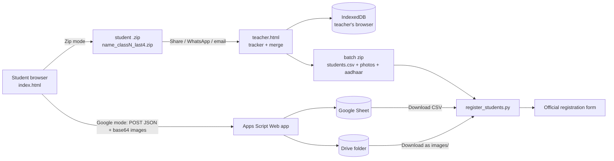
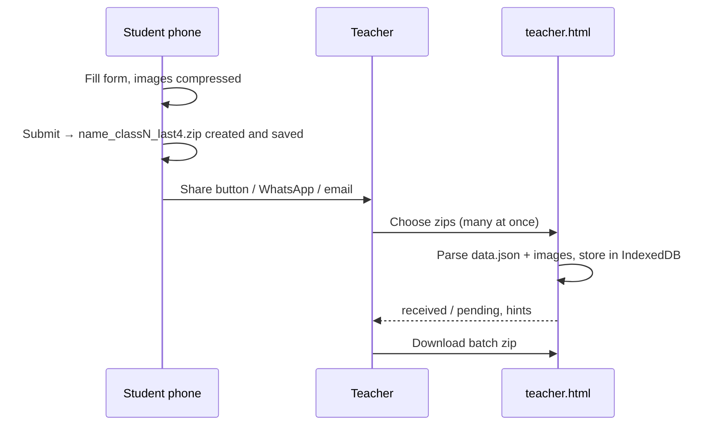
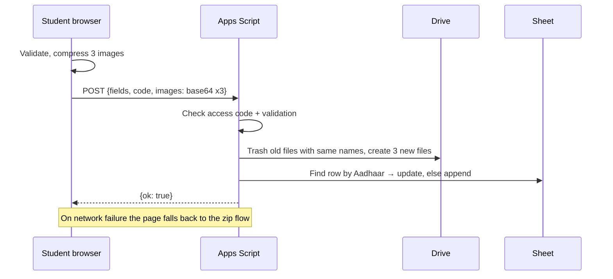

# Architecture

## 1. Overview

There is **no server of our own**. Everything is static files on GitHub Pages, Google services owned by the teacher (Google mode only), or code that runs on the teacher's computer.

**Mode selection** happens in `index.html` at load time: if `location.hash` contains `u=<Web app URL>` the page runs in **Google mode**, otherwise in **zip mode**. In Google mode a network failure falls back to the zip flow.

## 2. Components

| Component | File | Runs on | Responsibility |
|---|---|---|---|
| Student form | `index.html` | Student's browser | Fields, validation, image compression, zip creation, upload (Google mode), Share button |
| Teacher panel | `teacher.html` | Teacher's browser | Load zips, class list, received/pending, hints, batch export; optional Google link generator |
| Backend | `apps-script/Code.gs` | Google (teacher's account) | Access-code check, validation, save images to Drive, write/update Sheet row |
| Storage | Sheet + Drive | Teacher's Google account | Source of truth in Google mode |
| Automation | `automation/register_students.py` | Teacher's computer | Fill the official form |

## 3. The student form

### Fields and rules

| Field (data key) | Input | Rule |
|---|---|---|
| Student's Full Name (`student_name`) | text | required |
| Class (`class`) | dropdown, 1–12 (`CLASSES` in `index.html`) | required; used in file naming |
| Gender (`gender`) | radio Girl / Boy | required, no default |
| Aadhaar (`aadhaar`) | text, numeric | exactly 12 digits |
| Date of Birth (`dob`) | date picker, stored as `dd/mm/yyyy` | required |
| Age category (`category`, computed) | not typed; shown under the game dropdown | age on 1 March 2027 → `U-14` (13 or less), `U-16` (14–15), otherwise none (the student cannot choose a game) |
| Mother's / Father's name | text | required |
| Parent/Guardian mobile (`mobile`) | text, numeric | exactly 10 digits |
| E-mail (`email`) | email | optional; basic format check |
| Game (`game`) | dropdown, rebuilt from gender + age category (`GAMES` in `index.html`) | required; only eligible games are listed; Submit re-checks eligibility |
| Beneficiary name (`beneficiary_name`) | text | must equal student's, mother's or father's name (case/space-insensitive) |
| Account number (`account_number`) | text, numeric | 9–18 digits |
| IFSC (`ifsc`) | text | `AAAA0XXXXXX`, upper-cased |
| Photo / Aadhaar front / Aadhaar back | file (images) | all three required; compressed on selection |

Validation runs on Submit and lists every problem at once. The server (Google mode) re-checks the critical ones.

### Image compression

Goal: stay under the portal's "up to 200 KB" with a safety margin and maximum sharpness.

- Ceiling `LIMIT = 190000` bytes (about 185.5 KiB), safe for either 200,000 or 204,800 bytes.
- Decode with `createImageBitmap` (EXIF rotation honoured), draw on a white-filled canvas, export JPEG.
- Start size: longest side 1000 px for the passport photo, 1800 px for Aadhaar images.
- Per image: try quality 0.92; if within the limit, use it (small inputs may end well below 185 KB). Else try 0.35; if even that is too big, shrink dimensions by 20% and repeat (max 10 rounds). Else binary-search quality between 0.35 and 0.92 (8 steps) and keep the largest result that fits, typically 185–190 KB.

### Game eligibility

`GAMES` is a table of `[game, eligible categories, eligible genders]`; `CATS` holds the category cut-offs and `AGE_REF` is 1 March 2027 (the portal's "Age as on 1st March 2027").

| Game | Categories | Genders |
|---|---|---|
| Football | U-14, U-16 | Boy |
| Kabaddi | U-14, U-16 | Boy, Girl |
| Volleyball | U-16 | Boy |
| Cycling (3km) | U-14 | Boy, Girl |
| Cycling (5km) | U-16 | Boy, Girl |
| Long Jump (Athletics) | U-14, U-16 | Boy, Girl |
| 60m Sprint (Athletics) | U-14 | Boy, Girl |
| 100m Sprint (Athletics) | U-16 | Boy, Girl |
| 600m Long Run (Athletics) | U-14 | Boy, Girl |
| 800m Long Run (Athletics) | U-16 | Boy, Girl |

`refreshGames()` runs whenever gender or date of birth changes: it computes age and category, rebuilds the dropdown with only eligible games, keeps the previous choice if still eligible, and shows "Umar … Category …" (or an error if the age fits no category). The same rule is repeated in `validate()` and, in Google mode, in `Code.gs` (`GAMES`, `category_()`), where the category is recomputed from the DOB rather than trusted from the browser. The portal itself also filters its dropdown, so the portal remains the final authority.

## 4. Naming conventions

Base name: `<slug(student_name)>_class<class>_<last 4 digits of Aadhaar>`, where `slug` lower-cases and replaces every run of characters outside `a–z0–9` with `_`, trimming edge underscores (empty result → `student`).

| Artifact | Name |
|---|---|
| Student zip | `<base>.zip`, e.g. `ravi_kumar_class8_9012.zip` |
| Zip contents | `data.json`, `photo.jpg`, `aadhaar_front.jpg`, `aadhaar_back.jpg` |
| Drive images (Google mode) | `<base>_photo.jpg`, `<base>_aadhaar_front.jpg`, `<base>_aadhaar_back.jpg` |
| Batch export (teacher panel) | `students.csv`, `photos/<base>.jpg`, `aadhaar/<base>_front.jpg`, `aadhaar/<base>_back.jpg` |
| CSV columns for images | `photo`, `aadhaar_front`, `aadhaar_back` hold these relative paths/file names |

The name is for humans. **Identity** is the full Aadhaar number (de-duplication key); `data.json` is authoritative for contents. Two students sharing name + class + last 4 digits is practically impossible but would still be kept apart by full Aadhaar.

## 5. Zip mode

After Submit the zip is saved to the device and the student sees two sending options:

1. **Share button** (only if `navigator.canShare({files})` is true). It opens the system share sheet with the zip attached; the student picks WhatsApp there. It needs a fresh tap, so it is a separate button. Browsers only allow certain file types to be shared (Chrome's list covers audio, image, PDF, video and text files, so a `.zip` is often **not** shareable); the button is hidden when sharing is not possible.
2. **WhatsApp button**, a plain link `https://wa.me/<number>?text=<message>`. It opens WhatsApp (to the teacher's chat if the link carries `#w=<number>`, otherwise a contact chooser) with a prefilled message containing file name, name, class and game. **A web page cannot attach a file to WhatsApp**, so the student attaches the saved zip from Downloads with the 📎 button; the page shows this instruction.

The teacher's number comes from the constant `TEACHER_WHATSAPP` in `index.html`, and can be overridden per link with the hash `#w=919876543210` (generated in `teacher.html`, *Student link (Zip mode)*, which only works when opened from the real GitHub Pages URL).

### Teacher panel internals

- **Persistence:** each loaded zip is stored in IndexedDB database `bsg` (key = full Aadhaar), so zips can be added across several days. The class list is stored in `localStorage`. Both live only in that browser profile; **Sab hatayein** clears them.
- **Class list format:** one student per line, either `Ravi Kumar` or `Ravi Kumar, 8` (also `Ravi Kumar | class 8`). With a class, both name and class must match; without it, name alone is compared.
- **Matching:** names are normalised (lower-case; spaces, dots, commas, apostrophes, hyphens, underscores removed) and compared exactly. A roster entry with no exact match is **pending**; if a received name is within Levenshtein distance 2, a hint is shown ("shayad … ne bheja – spelling/class check karein"). A hint is not a match: fix the roster spelling or class to clear it. Received students not on the list are flagged ⚠.
- **Duplicates:** the same Aadhaar replaces the earlier entry.
- **Outputs:** Baaki list with a copy button (for WhatsApp reminders), Mil gaye list with per-student remove, progress bar, **Download batch zip**.
- Unreadable zips are listed by file name and skipped.

## 6. Google Sheet mode

**Student link:** `https://<user>.github.io/<repo>/#u=<encoded Web app URL>&c=<access code>`. Browsers do not send the `#` part to GitHub's servers; the page reads it locally. The teacher panel's *Google Sheet mode* section builds this link.

**`Code.gs`:**
- `setup()` creates/renames the `Students` sheet and headers, the `Roster` sheet with status formulas, and the Drive folder (ID in Script Properties).
- `doPost(e)` validates the code, name, class, Aadhaar (12 digits), mobile (10 digits), the three images (base64 length cap per image) and **game eligibility** (category recomputed from the DOB), then saves files and writes the row under a **script lock** so simultaneous submissions queue up.
- `doGet()` returns a plain "running" message; it **never returns stored data**.
- Deployed as *Execute as: Me*, *Who has access: Anyone*; the browser sends plain-text bodies so no CORS pre-flight is needed.

**Sheet `Students` columns:** `student_name, gender, aadhaar, dob, mother_name, father_name, mobile, email, game, beneficiary_name, account_number, ifsc, class, category, photo, aadhaar_front, aadhaar_back, submitted_at, photo_link, aadhaar_front_link, aadhaar_back_link`. Cells are written as plain text so numbers keep their digits and dates are not converted. Aadhaar must stay in **column C** (the dedupe lookup depends on it). Start a new Sheet if you ran an older version, because `class` and `category` were added to the column layout.

**Sheet `Roster`:** column A your class list, column B `✓ Mil gaya` / `Baaki` via `COUNTIF(Students!A:A, name)`. This matches **name only** (no class).

## 7. Automation (`register_students.py`)

Reads `students.csv`, resolves image paths (also in `images/`), validates each row, then drives Chromium via Playwright with a persistent profile (`pw_profile/`) so you log in once. The `class` column is carried in the CSV but the official form is not known to have a class field, so the script ignores it.

| Form field | Selector / method |
|---|---|
| Page preparation | At the start of `fill_student()` a style tag hides `#accessibility-overlay`: a fixed, z-index 999999, 40% black layer from the portal's accessibility widget (Ctrl+F2 button) that dimmed the whole form and intercepted mouse clicks |
| Name | `#formStudentName` fill |
| Gender | `#genderFemale` / `#genderMale` check |
| Aadhaar | `#formAadharNumber` fill |
| Date of birth | `input[placeholder="dd/mm/yyyy"]`: the whole date is set **at once** with `fill` (typing character by character makes the portal read partial text such as `0` as 01/01/2000 and show an "age restriction" error with a dimmed form, seen in a recorded run), then Tab, then wait up to 8 s for `#formAgeAsOn`. Retry once with fast typing; if Age stays empty the student fails with the portal's own error text |
| Age, Category | `#formAgeAsOn`, `#formCategory` read-only; the script only reads them as a check |
| Mother / Father / Mobile / Email | `#formMotherName`, `#formFatherName`, `#formMobileNumber`, `#formEmail` |
| Game | Focus the react-select input and press ArrowDown to open the menu (no mouse click, so a blocking overlay cannot stop it), read the options (`[id^='react-select-'][id*='-option-']`), move to the one whose text matches the CSV (exact, then contains) and press Enter only when the menu is open. If nothing matches, the portal's option list is printed; verified via hidden `input[name=gameName]` |
| Bank | `#formAccountHolderName`, `#formAccountNumber`, `#formIfscCode` |
| Uploads | Found by the box text, not by position: "Upload Student Photo", "Upload Front Side", "Upload Back Side" (nearest ancestor containing the file input). The portal removes an input once its file is accepted, so index-based lookup is unreliable; the script waits for the box label to disappear to confirm each upload Before each upload `scroll_modal_to()` scrolls the portal's modal (it has its own scroll container, so the page-level scroll did nothing) to the box and waits 1.5 s; after `set_input_files` the script waits another 1.5 s so the preview is visible in the video, then waits for the box label to disappear. |
| Submit | button "Register" inside the form (normal click, falling back to a JavaScript click). With `DRY_RUN = True` the script asks at a prompt after filling: **Enter** skips Register and moves on, typing **OK** (any case) clicks Register for that student anyway |

Each student is processed in a **new browser tab**, so Playwright's per-page video recording produces one file per student (`videos/<no>_<name>_<status>.webm`, 720p or 1080p, set by `VIDEO_QUALITY`); each tab is closed in a `finally` block as soon as its student ends (success, dry run or failure), so only one student tab exists at a time and memory stays flat; the persistent login tab is replaced by a blank page after login (it keeps the browser alive) and its video file is deleted at the end (the script closes the browser first, then removes the file by path; in `SINGLE_TAB` mode it is kept as `all_students_INCLUDES_LOGIN.webm`). Videos capture page content only and contain sensitive data (see security). Before the first student the script runs `probe_new_tab()`: a temporary tab loads the form URL and clicks the portal's **Register New Student** button (`open_form()`, configurable via `OPEN_FORM_BUTTON`), and the result (`Jaanch OK` / `JAANCH FAIL` with a reason) tells whether a new tab shares the login. When it passes, that tab (form already open) is **kept and used for the first student**, so the form is opened once, not twice; later students each get a fresh tab, which starts on the student list, and `open_form()` clicks the button there. `SINGLE_TAB = True` is the fallback that processes every student in the login tab (one combined video). Extra checks: rows whose Aadhaar/account/mobile contain `E+` are rejected (a sign the CSV was opened in Excel); if the CSV has a `category`, it is compared with the portal's `#formCategory` and a warning is printed on mismatch. Safety: `DRY_RUN = True` by default; pre-flight validation; post-fill checks; per-student screenshots in `proof/`; per-student failures do not stop the run.

**Browser launch.** Chromium starts with `--deny-permission-prompts`, so the portal's camera preview does not raise Chrome's "wants to use available cameras" popup (the camera boxes stay black; the script only uploads files). A line printed at start-up says so. If the popup still appears, click **Never allow** once; the choice is saved in `pw_profile/`.

**Observed portal behaviour (live dry run, one student).**
- The registration form is a modal with its own scrollbar; opening `/pages/register-student` first shows the student list ("Loading students…"), and the blue **Register New Student** button opens the form.
- `#accessibility-overlay` (see above) covers the page until hidden. After hiding it, `proof/overlay_info.txt` lists the modal body as the top element.
- After each upload the box is replaced by a preview with file name, size and a green tick; the Aadhaar front and back previews appear one at a time.
- Age is shown as text such as "15 years 11 months 20 days" and Category as "U-16 (Boys)"; the game control shows the chosen game as a chip and the hidden `input[name=gameName]` holds its value.
- A red "Invalid credentials" banner appeared once on the student list of a new tab (first recorded run) and did not recur; the form still opened and filled.

## 8. Security and privacy

| Aspect | Zip mode | Google mode |
|---|---|---|
| Repo | Code only | Code only (access code is a placeholder) |
| Data in transit | Student → you via WhatsApp/email (their security) | Student → Google over HTTPS |
| Data at rest | Students' phones/WhatsApp backups; your teacher-panel browser storage; your computer | Your private Sheet/Drive; your computer |
| Public endpoint | None | Apps Script Web app; anyone with the URL can try to POST. Protected by the access code, which is visible in the student link, so it is only a spam filter |
| Overwrite risk | None | Anyone who has the link and knows another student's Aadhaar can overwrite that entry (same-Aadhaar replace). Mitigation not yet built: also require the mobile number to match |
| Teacher panel | No password; data only in your browser | Same |
| Rotation | n/a | Change `ACCESS_CODE`, deploy a **new version**, regenerate and re-share the link |
| Third-party code | JSZip from cdnjs | JSZip from cdnjs |

General: use 2-step verification on the Google account, share nothing you do not need to, delete data after the event, and confirm consent requirements for minors' data with your institution.

## 9. Failure modes

| Situation | Behaviour |
|---|---|
| Missing/invalid field | Submit blocked, all problems listed |
| File is not an image | Slot shows an error, submit blocked |
| Wrong access code (Google) | Server message shown, no fallback |
| Network/server failure (Google) | Zip is downloaded as a fallback |
| Share not supported | Zip is just downloaded; send it manually |
| Corrupt zip in teacher panel | Listed as unreadable, skipped |
| Name spelt differently from roster | Stays pending with a hint |
| Game not offered by the portal | Script raises "Game '…' options mein nahi mila" and prints the portal's option list; or "koi option nahi aaya" if the dropdown is empty (e.g. no category) |
| Upload not accepted | Script raises "upload ke baad box nahi badla" for that student |
| CSV damaged by Excel (`E+`) | Row rejected with an explanation; export a fresh CSV |
| Student too old for any category | Form shows "Koi game eligible nahi" and blocks Submit; the server also rejects |
| Official portal down | Collection (form, Sheet, zips) is unaffected; the automation fails per student with a timeout screenshot, so rerun later |
| DOB not registered by the portal | Script raises "DOB '…' dalne ke baad Age nahi bhari" for that student and continues with the next |
| Screen dimmed, clicks seem ignored | The portal's accessibility overlay; hidden by the script. If it returns, check the first element in `proof/overlay_info.txt`. Register also falls back to a JavaScript click |
| Chrome camera popup | Blocked by `--deny-permission-prompts`; otherwise click Never allow once |
| "Invalid credentials" banner on the student list | Seen once in a new tab, not reproduced. If a real Register fails with it, set `SINGLE_TAB = True` |
| `OK` typed by mistake in dry run | That student is registered for real; there is no undo or resume, so remove them from the CSV before any rerun |

## 10. Assumptions to verify on first run

- The portal's DOB control accepts typed `dd/mm/yyyy` followed by Tab. **Confirmed** in a live dry run: Age and Category filled correctly.
- The portal's game labels match `GAMES` (the three newer ones, 100m Sprint (Athletics), 800m Long Run (Athletics) and Cycling (5km), are guesses based on the existing label style). **Volleyball** is confirmed on the live portal; the other labels are not yet.
- The age rule is "U-14 = 13 or less, U-16 = 14 or 15 on 1 March 2027". Compare the form's category with the portal's Category field on a few test DOBs, especially around the cut-off (birthdays near 1 March). One live case (15 years 11 months 20 days, U-16 Boys) matched; still test a girl, a U-14 student and dates near 1 March.
- Web Share with files works on your students' phones (varies by browser/OS).
- The registration form is reachable at the script's `URL` after login (each student after the first reloads that URL; if the form does not appear within 10 seconds that student fails and an error screenshot is saved).
- The portal has not added OTP/CAPTCHA or changed element IDs.
- **Not yet confirmed on the live portal:** the real **Register** click and the portal's success or error response.

## 11. Extending

- **Games / eligibility:** edit the `GAMES` array (and `CATS`, `AGE_REF`) in `index.html`, and keep `GAMES` and `category_()` in `Code.gs` identical. Labels must match the portal's dropdown text.
- **Classes:** edit `CLASSES` in `index.html`.
- **Size limit:** edit `LIMIT` in `index.html` and the per-image cap in `Code.gs`.
- **New field:** add it to `F1`/`F2` and validation in `index.html`, to `COLS` in `Code.gs` (append at the end of the data fields so Aadhaar stays in column C) and `COLS` in `teacher.html`, then map it in `register_students.py` if the portal needs it.
